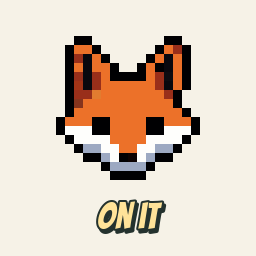
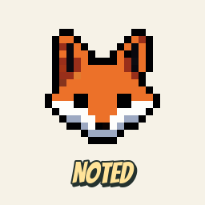
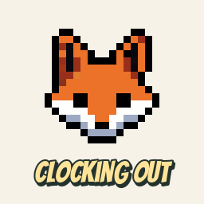
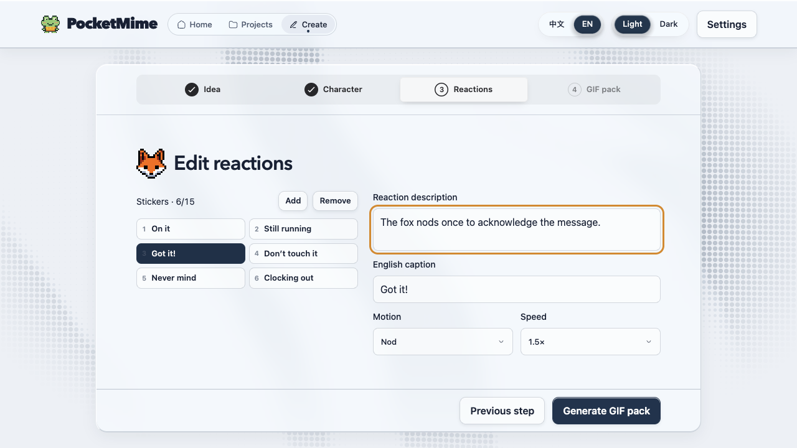

<h1 align="center">PocketMime</h1>

<p align="center">Turn one character and a few catchphrases into a pack of looping chat stickers.</p>

<p align="center">
  <a href="#run-locally">Quick start</a> ·
  <a href="#generate-characters-locally-with-tessera">Model setup</a> ·
  <a href="https://github.com/Hy-1990/pocketmime/releases/latest/download/pocketmime-x.mp4">21-second demo</a> ·
  <a href="README.zh-CN.md">简体中文</a>
</p>

<p align="center">
  <a href="https://github.com/Hy-1990/pocketmime/releases/latest/download/pocketmime-x.mp4"></a>
</p>

## Choose your setup

| What you want to do | What you need |
| --- | --- |
| Animate an uploaded image or the built-in frog and export 1–15 looping GIFs | 64-bit Python 3.12 and the base dependencies |
| Generate a pixel character from text or redraw its poses with a model | Base dependencies, model dependencies and Tessera Small ONNX weights |
| Draft reaction descriptions from a brief | A DeepSeek API key in Settings, or start with six local suggestions |

## Run locally

Use **64-bit Python 3.12** and a current browser. Run these commands from the project directory. The server listens on the loopback interface. Open **http://127.0.0.1:8765** and leave the terminal running. Stop it with Ctrl+C.

**macOS**

```sh
python3.12 -m venv .venv
.venv/bin/python -m pip install -r requirements.txt
.venv/bin/python app.py
```

**Windows (PowerShell)**

```powershell
py -3.12 -m venv .venv
.\.venv\Scripts\python.exe -m pip install -r requirements.txt
.\.venv\Scripts\python.exe app.py
```

### Generate characters locally with Tessera

Uploads, the built-in frog and basic GIF export work with the base dependencies above. For text-to-pixel characters and model-assisted pose redrawing, stop the server and complete these steps from the project root.

1. Install the model dependencies. On macOS run `.venv/bin/python -m pip install -r requirements-model.txt`. On Windows run `.\.venv\Scripts\python.exe -m pip install -r requirements-model.txt`.
2. Download the following four files from the [pinned Tessera Small ONNX release](https://huggingface.co/cfahlgren1/tessera-small-onnx/tree/bef21be58afea4d16be21f5fbe85eaa0cae69290). Keep their original names together in one directory.

   `tessera_w8.onnx` · `clip_text_w8.onnx` · `tokenizer.json` · `palette.json`

3. Copy [`pocketmime.example.toml`](pocketmime.example.toml) to `pocketmime.toml` in the project root. Set `directory` to the folder containing the four files. Use an absolute path or a path relative to the configuration file. On Windows, for example, use `"D:/Models/tessera-small-onnx"`.

```toml
[model]
directory = "../models/tessera-small-onnx"
```

The environment variable `POCKETMIME_MODEL_DIR` overrides the configuration file. With neither set, the example path above is the default. Restart the server and choose **Generate characters** to verify setup. The first generation downloads and verifies the sampler, then inference runs locally on the CPU.

Tessera is by **Jagrat Patel (TheJagStudio)**. The ONNX conversion and sampler are by **cfahlgren1**. The author specifies non-commercial use for Tessera and images generated with it. See the [original model terms](https://huggingface.co/thejagstudio/tessera-small#license). Model weights are stored separately from this project. The video uses a fox reference image, local pose templates and Tessera rendering.

## Make a pack

1. **Pick a character.** Upload a JPG or PNG, use the built-in frog, or generate candidates with Tessera.
2. **Plan its reactions.** Start with six suggestions. Edit each motion, caption and speed, and keep 1–15 reactions.
3. **Export the pack.** Preview the loops and download the GIFs as a ZIP. Reopen the project later to change a single sticker.

<p align="center">
  
  
  
</p>

Each GIF uses four poses. With Tessera and a DeepSeek key, DeepSeek writes anticipation, peak and recovery poses from your final descriptions. Tessera redraws selected regions of the confirmed character. Without a key, Tessera uses motion-specific pose templates. Without Tessera, a local sprite deformation supplies a basic preview and export.

**The four frames of “On it”, in playback order.**


<details>
<summary>View the home screen and reaction planner</summary>




</details>

## Settings and local data

- The header switches English/Chinese and light/dark appearance. Preferences persist in the current browser.
- Set a **DeepSeek API key** in Settings for the current server session, or set the environment variable `DEEPSEEK_API_KEY` before starting. DeepSeek condenses character briefs and translates Chinese image prompts into short English descriptions for Tessera. Descriptions follow the interface language. GIF captions use English and the bundled Bangers comic font. The API receives the brief, requested language and count when you request ideas. Images and GIFs are processed locally. `DEEPSEEK_MODEL` overrides the default `deepseek-flash`.
- Projects, uploaded images, drafts and confirmed GIFs live in `data/pocketmime.sqlite3`. Stop the app before copying this file as a backup. `POCKETMIME_DATA` changes the storage directory. Runtime data and credentials are excluded from Git. Downloads are managed by your browser.
- Captions use the bundled Bangers font. Set `POCKETMIME_FONT` to a suitable local font file to override it.

## Demo and checks

The [silent 1280 × 720 H.264 MP4](docs/media/pocketmime-demo.mp4) shows project creation, editing, confirmation and ZIP download. It can be used as an X post attachment.

Run `python -m unittest discover -s tests -v` with the virtual environment's Python. Tests cover GIF motion and looping, project limits, exporting the latest edited GIF, ZIP contents, and the DeepSeek request boundary using a mock response.
