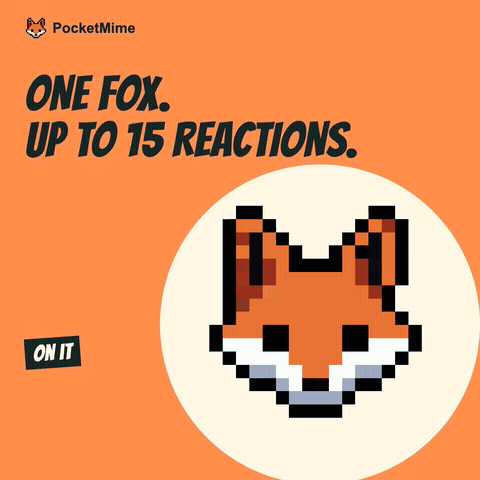
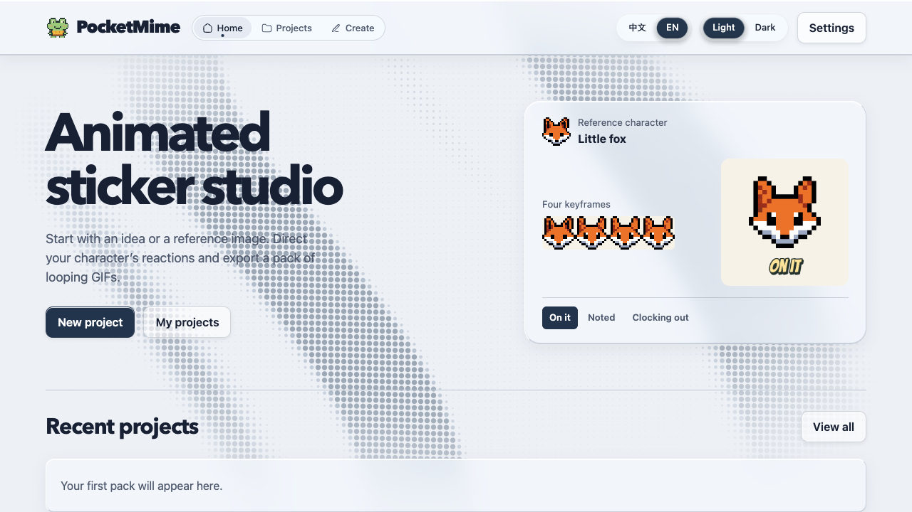

# PocketMime

[简体中文](README.zh-CN.md)

Make a pack of looping chat stickers from one character. Bring a JPG or PNG, use the PocketMime frog, or generate a pixel character locally with Tessera. Each project holds **1–15 animated stickers**.

[](https://github.com/Hy-1990/pocketmime/releases/latest/download/pocketmime-x.mp4)

[Download the 21-second film (MP4)](https://github.com/Hy-1990/pocketmime/releases/latest/download/pocketmime-x.mp4)

<p>
  
  
  
</p>



## Run locally

Use **64-bit Python 3.12** and a current browser. Run these commands from the project directory. The server listens on the loopback interface. Open **http://127.0.0.1:8765** and leave the terminal running. Stop it with Ctrl+C.

**macOS**

```sh
python3.12 -m venv .venv
.venv/bin/python -m pip install -r requirements.txt
.venv/bin/python app.py
```

**Windows (PowerShell)**

```powershell
py -3.12 -m venv .venv
.\.venv\Scripts\python.exe -m pip install -r requirements.txt
.\.venv\Scripts\python.exe app.py
```

## Make a pack

1. Enter an idea and optionally attach a PNG or JPEG. Generate character candidates, or choose the reference itself to preserve its appearance.
2. Confirm one character. PocketMime then opens six editable reaction descriptions. DeepSeek writes them when configured; offline mode starts with six local suggestions.
3. Select a reaction to change its description, caption, supported motion or speed. Add or remove entries (1–15). You can revisit completed steps. No project GIFs are rendered during planning.
4. Generate the pack once. All reactions animate the confirmed character. Preview the results and download one ZIP of looping GIFs. Projects stores the pack for later downloads or individual edits.

Each GIF uses four poses. With Tessera and a DeepSeek key, DeepSeek writes anticipation, peak and recovery poses from your final descriptions. Tessera redraws selected regions of the confirmed character. Without a key, Tessera uses motion-specific pose templates. Without Tessera, a local sprite deformation supplies a basic preview and export.

**The four frames of “On it”, in playback order.**


## Settings and local data

- The header switches English/Chinese and light/dark appearance. Preferences persist in the current browser.
- Set a **DeepSeek API key** in Settings for the current server session, or set the environment variable `DEEPSEEK_API_KEY` before starting. DeepSeek condenses character briefs and translates Chinese image prompts into short English descriptions for Tessera. Descriptions follow the interface language. GIF captions use English and the bundled Bangers comic font. The API receives the brief, requested language and count when you request ideas. Images and GIFs are processed locally. `DEEPSEEK_MODEL` overrides the default `deepseek-flash`.
- Projects, uploaded images, drafts and confirmed GIFs live in `data/pocketmime.sqlite3`. Stop the app before copying this file as a backup. `POCKETMIME_DATA` changes the storage directory. Runtime data and credentials are excluded from Git. Downloads are managed by your browser.
- Captions use the bundled Bangers font. Set `POCKETMIME_FONT` to a suitable local font file to override it.

## Optional local character generation

Install `requirements-model.txt` using the same virtual environment. Put the following four files from the [pinned ONNX release](https://huggingface.co/cfahlgren1/tessera-small-onnx/tree/bef21be58afea4d16be21f5fbe85eaa0cae69290) in **one folder**: `tessera_w8.onnx`, `clip_text_w8.onnx`, `tokenizer.json`, `palette.json`.

The default is `../models/tessera-small-onnx` relative to the project. To use another folder, set `POCKETMIME_MODEL_DIR` before starting. Enter a short English character description and select **Generate characters** to pick from three candidates. On first use the app fetches the pinned Python sampler from Hugging Face, checks its SHA-256 and caches it in `data/model/`. Subsequent inference uses the local CPU. Uploads, presets and manual editing work without this setup or an API key.

Tessera is by **Jagrat Patel (TheJagStudio)**. The ONNX conversion and sampler are by **cfahlgren1**. The author specifies non-commercial use for Tessera and images generated with it. See the [original model terms](https://huggingface.co/thejagstudio/tessera-small#license). Model weights are stored separately from this project. The video uses a fox reference image, local pose templates and Tessera rendering.

## Demo and checks

The [silent 1280 × 720 H.264 MP4](docs/media/pocketmime-demo.mp4) shows project creation, editing, confirmation and ZIP download. It can be used as an X post attachment.

Run `python -m unittest discover -s tests -v` with the virtual environment's Python. Tests cover GIF motion and looping, project limits, exporting the latest edited GIF, ZIP contents, and the DeepSeek request boundary using a mock response.
