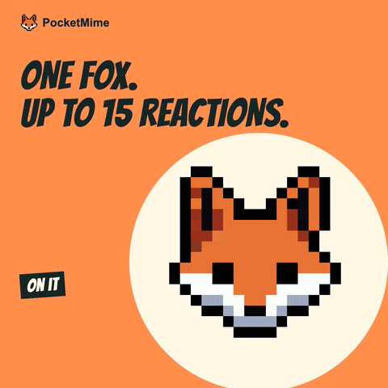
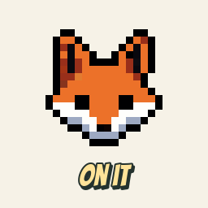
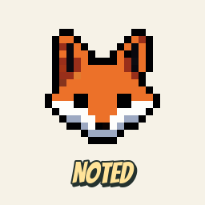
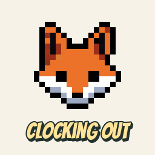
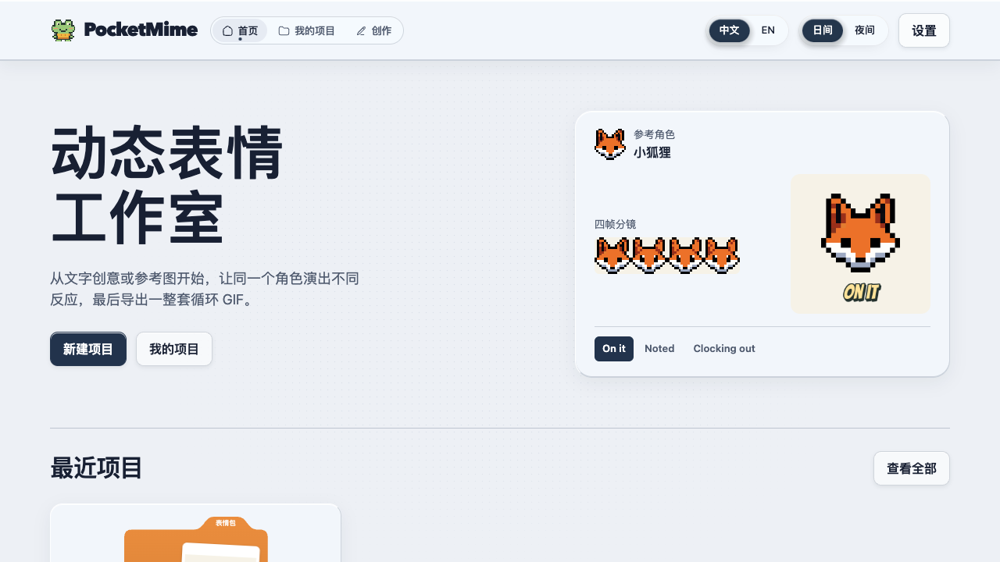
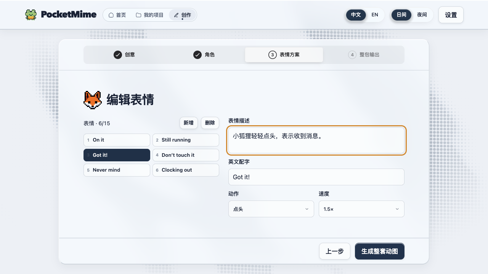

<h1 align="center">PocketMime</h1>

<p align="center">用一个角色和几句口头禅，做一套能在聊天里发的动态表情。</p>

<p align="center">
  <a href="#本地启动">本地启动</a> ·
  <a href="#使用-tessera-在本机生成角色">配置模型</a> ·
  <a href="https://github.com/Hy-1990/pocketmime/releases/latest/download/pocketmime-x.mp4">21 秒演示</a> ·
  <a href="README.md">English</a>
</p>

<p align="center">
  <a href="https://github.com/Hy-1990/pocketmime/releases/latest/download/pocketmime-x.mp4"></a>
</p>

## 选择制作方式

| 想做什么 | 需要准备 |
| --- | --- |
| 用自己的图片或内置青蛙做表情，导出 1～15 个循环 GIF | 64 位 Python 3.12 和基础依赖 |
| 从文字生成像素角色，或让模型重绘动作 | 基础依赖、模型依赖和 Tessera Small ONNX 权重 |
| 根据创意拟定表情描述 | 在设置中填写 DeepSeek API Key；也可从六条本地建议开始 |

## 本地启动

准备 **64 位 Python 3.12** 和现代浏览器，在项目目录中执行以下命令。启动后打开 **http://127.0.0.1:8765**，保持终端运行。按 Ctrl+C 停止服务。

**macOS**

```sh
python3.12 -m venv .venv
.venv/bin/python -m pip install -r requirements.txt
.venv/bin/python app.py
```

**Windows（PowerShell）**

```powershell
py -3.12 -m venv .venv
.\.venv\Scripts\python.exe -m pip install -r requirements.txt
.\.venv\Scripts\python.exe app.py
```

### 使用 Tessera 在本机生成角色

上传角色、使用内置青蛙和导出基础 GIF 只需要上面的基础依赖。要从文字生成像素角色或用模型重绘动作，请先停止服务，在项目根目录按以下步骤配置。

1. 安装模型依赖。macOS 执行 `.venv/bin/python -m pip install -r requirements-model.txt`，Windows 执行 `.\.venv\Scripts\python.exe -m pip install -r requirements-model.txt`。
2. 打开[固定版本的 Tessera Small ONNX 下载页](https://huggingface.co/cfahlgren1/tessera-small-onnx/tree/bef21be58afea4d16be21f5fbe85eaa0cae69290)，下载以下四个文件，保留原文件名并放在同一目录。

   `tessera_w8.onnx` · `clip_text_w8.onnx` · `tokenizer.json` · `palette.json`

3. 将项目根目录下的 [`pocketmime.example.toml`](pocketmime.example.toml) 复制为 `pocketmime.toml`，把 `directory` 改成存放这四个文件的目录。支持绝对路径，也支持相对于配置文件的路径。Windows 示例为 `"D:/Models/tessera-small-onnx"`。

```toml
[model]
directory = "../models/tessera-small-onnx"
```

环境变量 `POCKETMIME_MODEL_DIR` 优先于配置文件。两者均未设置时使用上例路径。重新启动服务，点击「生成候选角色」验证配置。首次生成需要联网下载并校验采样器，之后使用本地 CPU 推理。

Tessera 的作者是 **Jagrat Patel（TheJagStudio）**，ONNX 转换和采样器来自 **cfahlgren1**。作者要求模型及其生成图像仅用于非商业用途，详见[模型许可说明](https://huggingface.co/thejagstudio/tessera-small#license)。权重独立存放，视频使用狐狸参考图、本地预设分镜与 Tessera 实际渲染。

## 做一套表情包

1. **选角色。** 上传 JPG 或 PNG、选用内置青蛙，或用 Tessera 生成候选角色。
2. **编表情。** 从六条建议开始，逐条调整动作、配字和速度。每套可留 1～15 条。
3. **导出。** 预览循环效果，下载整套 GIF 的 ZIP。之后可以从项目记录里打开，只修改其中一张。

<p align="center">
  
  
  
</p>

每个 GIF 由四个姿态组成。配置 Tessera 和 DeepSeek 后，DeepSeek 按最终描述编排起势、主要表现和收势，Tessera 在确认角色的局部重绘。仅有 Tessera 时使用本地动作分镜；没有 Tessera 时使用基础的局部形变生成预览和成品。

**「On it」的四个画面，按播放顺序排列。**


<details>
<summary>查看首页与编辑器截图</summary>





</details>

## 设置和数据

- 在顶栏直接切换中文、English 以及日间、夜间模式。界面偏好保存在当前浏览器中。
- DeepSeek API Key 可在设置中输入，仅供本次服务进程使用；也可在启动前设置环境变量 `DEEPSEEK_API_KEY`。生成角色时，DeepSeek 将创意提炼为简短英文视觉描述，中文绘图提示也会先翻译再送入 Tessera。描述可用中文，GIF 配字统一使用英文和随项目附带的 Bangers 漫画字体。请求 AI 建议时，服务向 DeepSeek 发送创意文本、语言和数量。角色图和动图在本地处理。可用 `DEEPSEEK_MODEL` 覆盖默认模型 `deepseek-flash`。
- 项目、角色图、草稿与已确认的 GIF 保存在 `data/pocketmime.sqlite3`，停止服务后复制此文件即可备份。可用 `POCKETMIME_DATA` 指定其他目录。运行数据已排除在 Git 之外。下载文件的位置由浏览器设置决定。
- 配字默认使用项目内置的 Bangers 字体。如需其他字体，可用 `POCKETMIME_FONT` 指向本地字体文件。

## 宣传素材与检查

[无声 MP4 演示](docs/media/pocketmime-demo.mp4)为 1280 × 720、H.264 编码，展示创建、编辑、确认和下载流程，可以作为 X 帖子的视频附件。

使用虚拟环境的 Python 执行 `python -m unittest discover -s tests -v`，检查循环动图、项目数量限制、草稿和历史成品、ZIP 内容及 DeepSeek 请求处理。测试使用模拟 API 响应。
